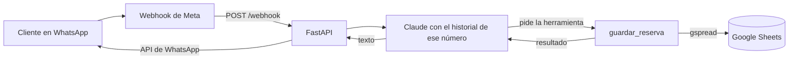

# Asistente de WhatsApp para un bar (FastAPI + API de Claude)

Servidor en Python que contesta por **WhatsApp** a los clientes de un bar. Responde con la **API de Claude** (`claude-haiku-5-5`) usando solo los datos del bar (horario, carta, alérgenos y normas), **recuerda la conversación de cada número de teléfono** y, cuando el cliente quiere reservar, **guarda la reserva en Google Sheets** mediante *tool use*.

El bar es inventado: **Tabanco La Bota**, en Jerez. Sus datos están en [`datos/bar.json`](datos/bar.json) y no corresponden a ningún local real.

## Pruébalo
**👉 [asistente-bar-whatsapp.onrender.com/chat](https://asistente-bar-whatsapp.onrender.com/chat)**

Es un chat web que usa el mismo asistente que WhatsApp, con el mismo código, los mismos datos y las mismas reservas, para que cualquiera pueda probarlo sin estar en la lista de números verificados de Meta. Pregúntale por el horario o la carta, o haz una reserva.

> Está en el plan gratuito de Render: si nadie lo ha usado en 15 minutos, el primer mensaje puede tardar alrededor de un minuto en responder.

## Qué hace
Un cliente escribe por WhatsApp:
> Hola, ¿tenéis mesa para 4 el sábado a las 21:00? Soy Marta

El asistente le contesta con los datos del bar y, cuando ya tiene nombre, día, hora y número de personas, añade una fila a la hoja:

| Nombre | Día | Hora | Personas | Teléfono | Guardada el |
|---|---|---|---|---|---|
| Marta | 2026-11-21 | 21:00 | 4 | (número del cliente) | 2026-11-19 13:50 |

*(Fila de ejemplo con datos ficticios.)*

## Cómo funciona


1. **Webhook**: Meta me manda cada mensaje nuevo a `POST /webhook`. Los avisos de "entregado" o "leído" los ignoro.
2. **Memoria**: guardo la conversación de cada número en un diccionario (`número → lista de mensajes`) y se la paso entera a Claude, no solo el último mensaje.
3. **Claude**: le doy como instrucciones los datos del bar y la fecha de hoy, para que entienda "mañana" o "el sábado".
4. **Bucle de herramientas**: mientras Claude pida usar `guardar_reserva`, la ejecuto y le devuelvo el resultado; cuando ya no pide ninguna, me quedo con su texto.
5. **Google Sheets**: `guardar_reserva` añade una fila con **gspread** usando una cuenta de servicio.
6. **Respuesta**: mando el texto de Claude al cliente con la API de WhatsApp de Meta.

## Normas que puse en el código
- **Más de 8 personas → que llamen al bar.** `guardar_reserva` no guarda la reserva y le dice a Claude que el cliente tiene que llamar. No lo dejo solo en el prompt: lo compruebo en Python.
- **Si Google falla, nunca confirma la reserva.** Si `append_row` da error, la herramienta devuelve "No guardada: ha habido un problema técnico", así que Claude no puede decir que está reservado.
- **Solo texto.** Si llega un audio, una foto o una ubicación, contesta "De momento solo entiendo mensajes de texto 🙂" sin llamar a Claude.
- **Reservas web con teléfono.** Desde el chat web no tengo el número del cliente, así que Claude se lo pide y `guardar_reserva` no guarda la reserva sin él.
- **Límites de uso para la demo pública.** Cada visitante puede mandar 20 mensajes al día (contados por IP en la web y por número en WhatsApp), hay un máximo de 200 al día entre todos y cada mensaje puede tener hasta 500 caracteres. Así nadie puede gastarse el saldo de la API.
- Además, en las instrucciones: solo responde con datos del bar, si algo no está dice que no lo sabe, las quejas las pasa a una persona y los alérgenos los tiene que confirmar el camarero.

## Rutas
| Ruta | Para qué |
|---|---|
| `GET /` | Comprobar que el servidor está funcionando |
| `GET /horario` | Horario del bar (desde `bar.json`) |
| `GET /carta` | Carta con precios y alérgenos |
| `POST /preguntar` | Hablar con el asistente **sin WhatsApp**, para probar |
| `GET /webhook` | Verificación del webhook por parte de Meta |
| `POST /webhook` | Mensajes nuevos de WhatsApp |

## Probarlo en local
1. Crea el entorno virtual e instala las dependencias:
```powershell
python -m venv .venv
.venv\Scripts\Activate.ps1
pip install -r requirements.txt
```
2. Copia [`.env.example`](.env.example) a `.env` y rellena tus claves (Anthropic, WhatsApp y Google). El `.env` está en el `.gitignore`.
3. Arranca el servidor:
```powershell
uvicorn main:app --reload
```
4. Pregúntale algo a través de `/preguntar`:

En Windows (PowerShell):
```powershell
Invoke-RestMethod -Method Post -Uri http://localhost:8000/preguntar -ContentType "application/json" -Body '{"mensaje": "¿Abrís el lunes?"}'
```

Con curl:
```bash
curl -X POST http://localhost:8000/preguntar \
  -H "Content-Type: application/json" \
  -d '{"mensaje": "¿Abrís el lunes?"}'
```

`/preguntar` usa siempre el número `"prueba"`, así que todas las pruebas comparten la misma conversación hasta que reinicias el servidor.

Ojo: el servidor se conecta a Google Sheets al arrancar, así que necesita `GOOGLE_SHEET_ID` y `GOOGLE_CREDENCIALES` aunque solo quieras probar `/preguntar`.

Para WhatsApp, en Meta for Developers configuras el webhook con una URL pública que apunte a tu servidor (`/webhook`) y el mismo `WHATSAPP_VERIFY_TOKEN` que pusiste en el `.env`.

## Configurar Google Sheets
1. Crea una hoja con estas columnas, **en este orden**, en la primera pestaña:
   `Nombre`, `Día`, `Hora`, `Personas`, `Teléfono`, `Guardada el`
2. Crea una **cuenta de servicio** en Google Cloud y descarga su llave JSON. Guárdala **fuera del proyecto** y pon su ruta en `GOOGLE_CREDENCIALES`.
3. **Comparte la hoja con el correo de la cuenta de servicio como Editor.** Si no, no puede escribir.
4. Copia el ID de la hoja (está en su URL) en `GOOGLE_SHEET_ID`.

## Problemas que encontré y cómo los resolví
- **Reservas en un archivo local.** La primera versión del *tool use* guardaba las reservas en `reservas.json`, dentro del servidor. Como ese archivo llevaba teléfonos de clientes, lo tuve que meter en el `.gitignore`. Después lo cambié por **Google Sheets**, y al hacerlo añadí el control de errores: si Google falla, Claude no confirma la reserva.
- **Claude no sabe qué día es.** Si un cliente decía "el sábado", no tenía forma de saber qué fecha era. Lo resolví añadiendo a las instrucciones, en cada mensaje, el día de la semana y la fecha de hoy.
- **Meta no solo manda mensajes.** Al webhook también llegan avisos de mensaje entregado o leído, que no traen texto. Ahora compruebo que venga `messages` antes de hacer nada.
- **Nadie podía probarlo.** El número de prueba de Meta solo escribe a 5 números verificados. Para enseñarlo, hice un chat web que llama a la misma función que WhatsApp y lo desplegué en Render.
- **Reservas web sin forma de contacto.** En el chat web no hay número de teléfono, así que las reservas se guardaban con un identificador interno. Ahora Claude le pide el teléfono al cliente, y el código no guarda la reserva sin él.
- **Una demo pública gasta mi saldo.** Puse límites de mensajes por visitante y por día para que nadie pueda gastarse el saldo de la API.

## Limitaciones actuales
- **La memoria se pierde al reiniciar.** Las conversaciones y los contadores de los límites están en memoria: si el servidor se reinicia o Render lo duerme, el asistente olvida todo lo hablado.
- **Número de prueba de Meta.** Por WhatsApp solo pueden escribirle los números verificados en la app de Meta. Para un bar real haría falta un número propio.

## Siguientes mejoras
- **Guardar las conversaciones en una base de datos**, para que no se pierdan al reiniciar.
- **Confirmar por WhatsApp las reservas hechas en la web**, con un código que el cliente manda desde su teléfono. Ya lo tengo programado y probado, pero todavía no lo he incorporado.
- **Número real de WhatsApp** si lo usa un bar de verdad (ver [`docs/despliegue.md`](docs/despliegue.md)).

---
Hecho por Alejandro Corral · [Más proyectos en GitHub](https://github.com/alejandrocorral509)
